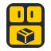
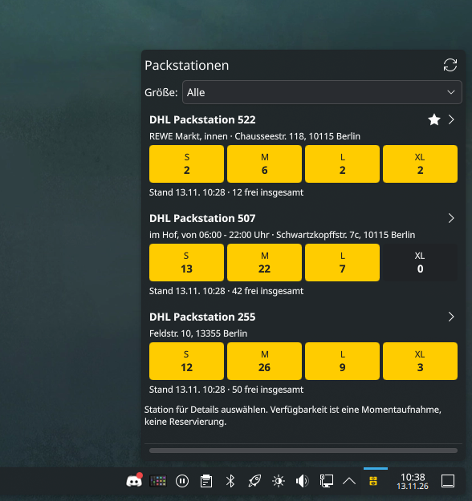

<p align="center">
  
</p>

# Packstation für KDE Plasma 6

Freie DHL-Packstationsfächer direkt auf deinem Desktop, in der Kontrollleiste oder neben der Uhr. Vergleiche bis zu drei Stationen – ohne Backend oder API-Schlüssel.

## Features

- **S, M, L und XL vergleichen**, inklusive Größenfilter und Detailansicht
- **Favorit im Panel**, Vergleich per Klick im Systemabschnitt
- **Gemeinsame Stationseinstellungen** für alle Widget-Instanzen
- Automatische Aktualisierung alle **5 Minuten**, manuell jederzeit
- KDE-Theme, adaptive Darstellung und Warnung bei veralteten Daten

## Screenshot

<p align="center">
  
</p>

## Installation

Benötigt **KDE Plasma 6** mit den üblichen QtQuick-, Kirigami- und KCMUtils-Modulen, beispielsweise unter CachyOS.

Repository herunterladen und im Projektordner ausführen:

```sh
kpackagetool6 --type Plasma/Applet --install ./package
```

Danach über **Miniprogramme hinzufügen → Packstation** platzieren. Für den Systemabschnitt den Eintrag **Packstation** in dessen Einstellungen aktivieren.

**Update inklusive Plasma-Neustart** (Anwendungen bleiben geöffnet):

```sh
./update-widget.sh
```

## Einrichtung

1. Im [DHL-Standortfinder](https://www.dhl.de/de/privatkunden/dhl-standorte-finden.html?address=10115&locationType=packstationen) nach deiner Postleitzahl suchen und eine Packstation auswählen. Dort findest du ihre **Packstationsnummer** und die **Postleitzahl des Standorts**.
2. Rechtsklick auf das Widget → **Packstation einrichten**. Unter **Packstation** die Standort-ID eintragen. Sie setzt sich so zusammen:

   ```text
   1-<Postleitzahl><Packstationsnummer>
   ```

   **Beispiel:** PLZ `10115` + Packstation `522` → **`1-10115522`**.
   Zwischen PLZ und Nummer stehen **keine Leerzeichen, kein weiterer Bindestrich und kein `&`**. Verwende die PLZ der Packstation, nicht gegebenenfalls deine eigene.

3. Optional einen **Kurznamen** vergeben, bis zu zwei weitere Stationen ergänzen und den **Favoriten fürs Panel** auswählen. Nicht benötigte Stationsfelder leer lassen.
4. **Anwenden** bzw. **OK** klicken. Die Stationen werden abgerufen; die Einstellungen gelten auch für die anderen Instanzen des Widgets.

Gelb bedeutet freie Fächer, `0` keine freien Fächer und `—` fehlende Daten. Die Panelzahl gehört zur Favoritenstation, nicht zur Summe aller Standorte.

## Hinweise

Inoffizielles Projekt, nicht mit DHL verbunden. Die öffentliche DHL-Schnittstelle kann sich ändern. Verfügbarkeit ist eine Momentaufnahme und keine Reservierung. Abfragen übermitteln die Standort-ID direkt an DHL; keine zusätzliche Telemetrie.

[Weitere Dokumentation](docs/GUIDE.md) · [Releases & KDE Store](docs/RELEASING.md) · [MIT-Lizenz](LICENSE)
